# Fluency – Live-Übersetzer, vollständig offline

Android-App (Kotlin, Jetpack Compose, Material 3) für das **Samsung Galaxy S26 Ultra**
(arm64-v8a, minSdk 31, targetSdk 37). Spracherkennung, Übersetzung und Sprachausgabe laufen
**komplett auf dem Handy**: kein API-Schlüssel, keine Cloud, kein ML Kit, keine Telemetrie.
Das Internet wird nur für den einmaligen Modell-Download gebraucht, danach funktioniert alles im
Flugmodus.

| Live | Wort ersetzen (Finger auf dem Knopf) | Wortlisten | Englisch: Sprache des Originals | Deutsch → Englisch |
|---|---|---|---|---|
| 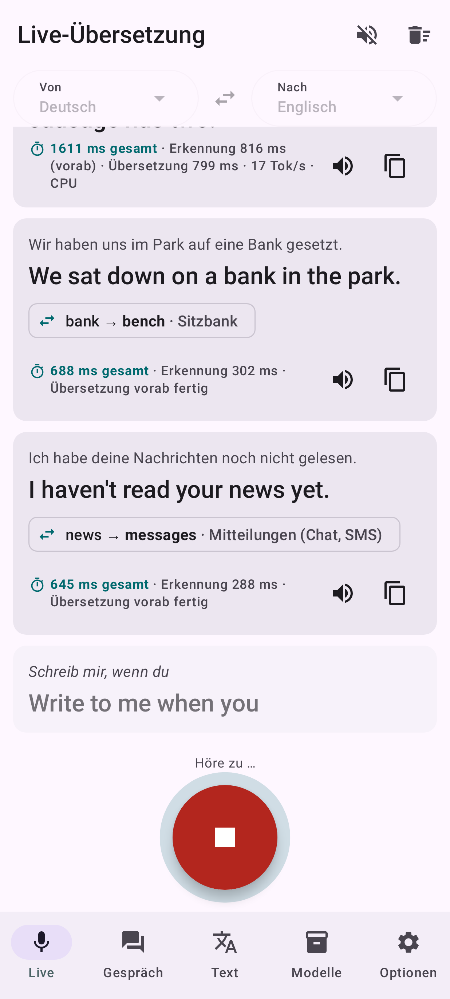 | 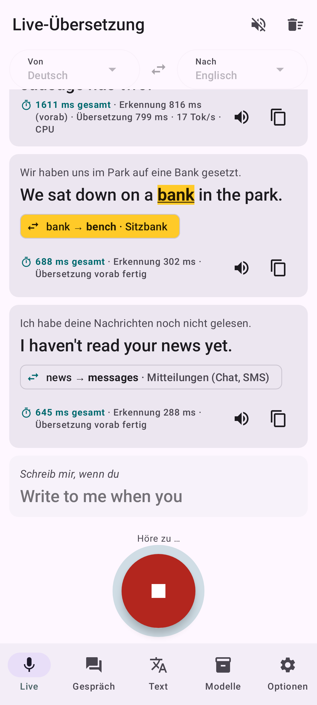 | 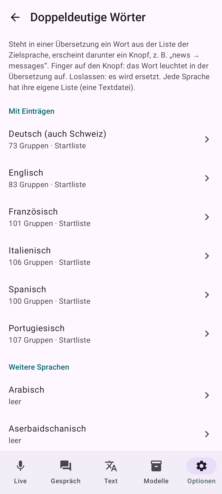 | 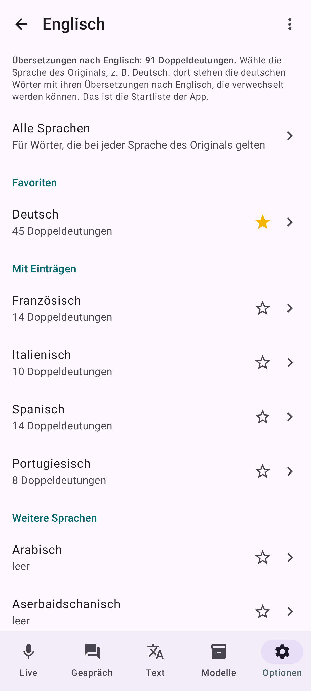 | 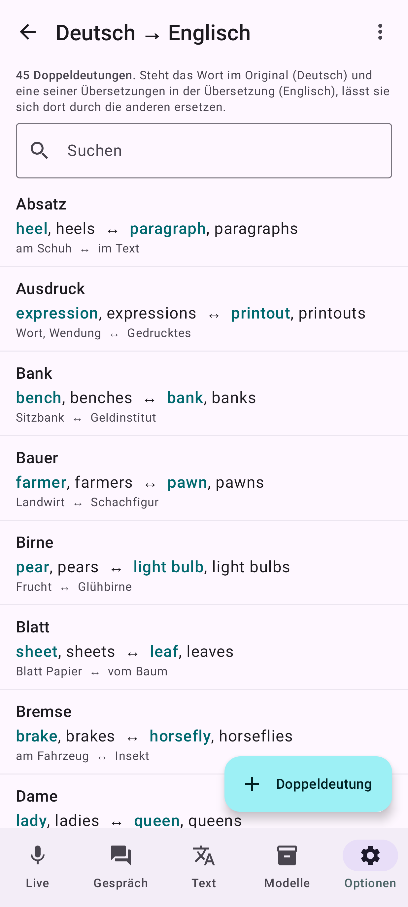 |

| Gespräch | Text | Modelle | Benchmark | Optionen |
|---|---|---|---|---|
| 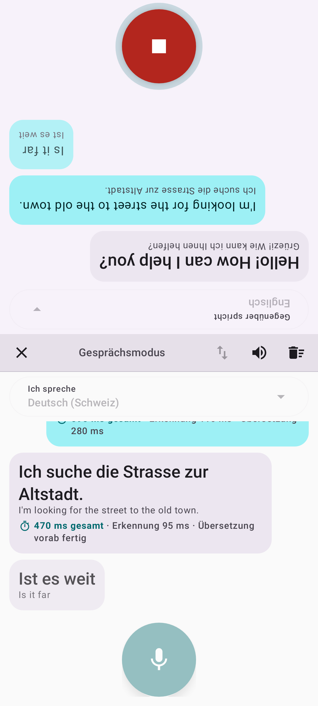 | 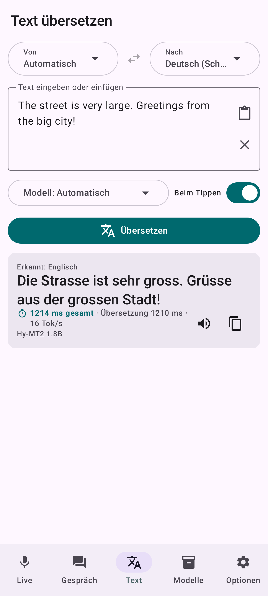 | 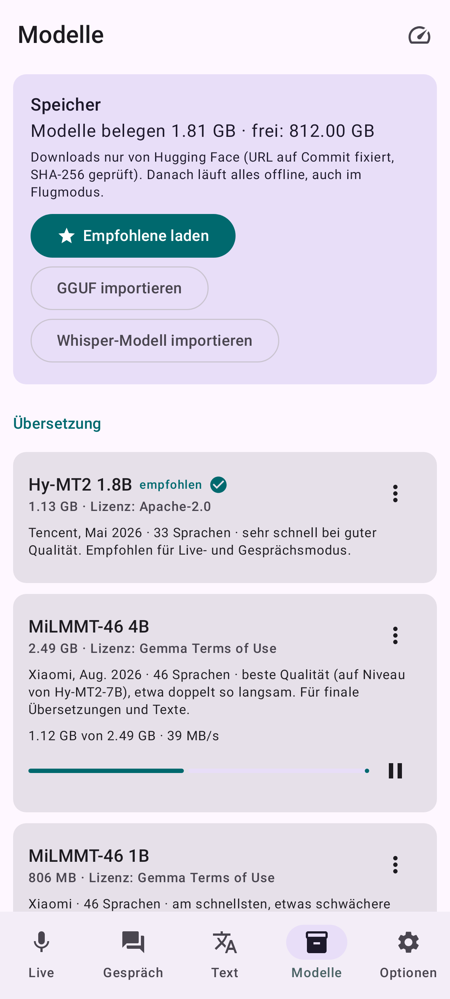 | 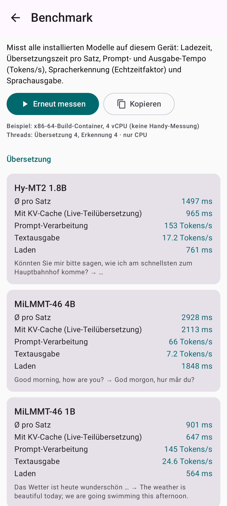 | 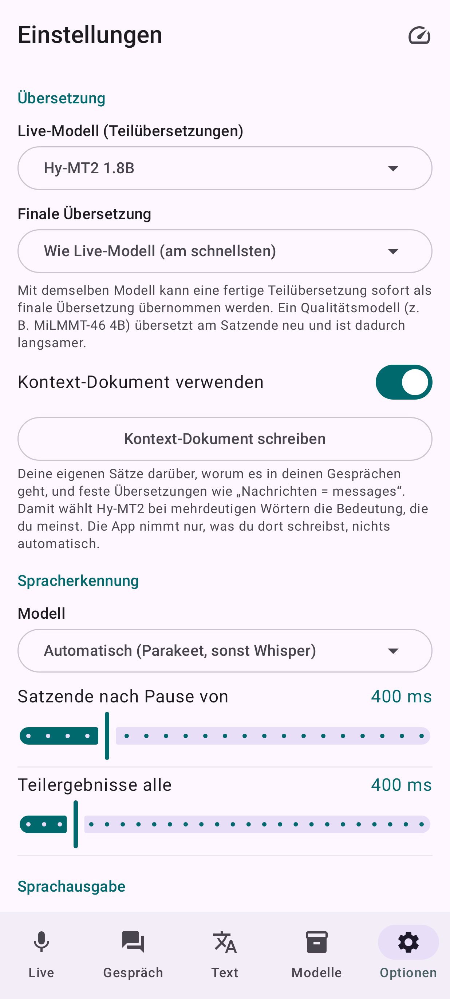 |

Die Screenshots sind Robolectric-Renderings (`ScreenshotTest`). Die Texte und Zahlen darin stammen
aus den Integrationstests auf dem x86-Build-Container. Es sind **keine Handy-Messungen**; die zwei
falschen Übersetzungen im Live-Bild („bank“, „news“) sind von Hand gesetzt, um die Knöpfe zu zeigen.

**Neu in 1.9.0: Untertitel auf der Brille** (Funktion 9). Fluency übersetzt für die App „Fluency“ auf
der Brille Even Realities G2, die von der Uhr-App G2 Watch gesteuert wird; der Ton kommt vom Mikrofon der
Uhr oder des Handys. Die Gegenstücke sind gebaut: G2 Watch ab 0.10.0 mit der Handy-App „G2 Handy“ und das Paket
Fluency 1.1.0 im Repo [MADTreasures/ER-G2-custom](https://github.com/MADTreasures/ER-G2-custom); wie man alles
einrichtet, steht dort im README unter „Apps auf dem Handy“. Alles ist nur mit Tests geprüft, nicht auf
Hardware.

**Version 1.8.0 baut auf 1.2.0 auf.**
- **Zurückgenommen** sind die Änderungen von 1.3.0 bis 1.6.0 an der Übersetzung:
  kontextbezogene Übersetzung, Kontextdokument und das Modul „Mehrdeutige Wörter“, das dem Modell
  Bedeutungen vorgab. Die Übersetzung läuft wieder genau wie in 1.2.0.
- **Wieder eingebaut** ist die schnellere Schweizerdeutsch-Erkennung aus 1.3.0 (Q8_0, mehr Threads).
- **Neu**: doppeldeutige Wörter unter der Übersetzung ersetzen (Funktion 8). Seit 1.8.0 sind die
  Wortlisten nach Sprachpaaren geordnet, und Sprachen lassen sich favorisieren.

## Downloads

- **Fertige App**: [`dist/Fluency-1.8.0.apk`](../dist/Fluency-1.8.0.apk) (arm64, signiert). Sie
  installiert sich als Update über 1.0.0 bis 1.7.0, die heruntergeladenen Modelle und deine
  Wortlisten bleiben erhalten.
- **Projekt für Android Studio**: [`dist/Fluency-AndroidStudio-1.8.0.zip`](../dist/Fluency-AndroidStudio-1.8.0.zip)
  (enthält alle nativen Quellen und die fertig gebauten NPU-Bibliotheken, keine Submodule)
- **1.9.0** (Brille) gibt es noch nicht als fertige APK und ZIP. Sie steckt im Quellcode dieses Repos;
  gebaut wird sie wie unten beschrieben, mit deinem Schlüssel, damit die Modelle erhalten bleiben.

## In Android Studio bauen

1. ZIP herunterladen und entpacken. Unter Windows einen kurzen Pfad wählen, z. B. `C:\dev\Fluency`
   (der native Build erzeugt tiefe Pfade). Alternativ funktioniert auch GitHubs „Code → Download
   ZIP“ des ganzen Repos; dann den Ordner `fluency` öffnen.
2. Android Studio (aktuelle Version mit Unterstützung für AGP 9.4) → **Open** → Ordner `Fluency`.
3. Gradle-Sync abwarten. Android Studio lädt Gradle 9.8, AGP 9.4.1, Android SDK 37, NDK
   30.0.16248370 und CMake 3.31.6 selbst; eventuell musst du SDK-Lizenzen bestätigen.
4. Handy per USB/WLAN verbinden → **Run ▶**. Der erste Build dauert einige Minuten, weil
   llama.cpp (7 CPU-Varianten, KleidiAI, OpenCL) und whisper.cpp aus dem Quellcode gebaut werden.
5. **Empfohlen**: `fluency-release.jks` ablegen und `keystore.properties.example` als
   `keystore.properties` kopieren und ausfüllen. Dann werden Debug- *und* Release-Builds mit deinem
   Schlüssel signiert, und „Run“ aktualisiert die installierte App, ohne dass die heruntergeladenen
   Modelle verloren gehen. Ohne diese Datei wird mit dem Debug-Schlüssel signiert; dann muss eine
   vorher installierte Release-Version zuerst deinstalliert werden.
6. Release-APK: *Build → Generate Signed App Bundle or APK* oder `./gradlew assembleRelease`
   → `app/build/outputs/apk/release/`.

Python wird nicht gebraucht. Die GPU-Kernel bettet ein CMake-Skript ein
(`app/src/main/cpp/cmake/`); es erzeugt dieselben Dateien wie das Python-Skript von llama.cpp.

## Funktionen

1. **Live-Modus**: Du sprichst, Untertitel und Übersetzung wachsen mit. Etwa alle 400 ms gibt es
   ein Teilergebnis. Sobald du eine Sprechpause machst (~160 ms), werden Erkennung und Übersetzung
   sofort gestartet. Wenn der VAD danach das Satzende bestätigt, wird dieses Vorab-Ergebnis
   übernommen, statt neu zu rechnen. Optional wird die Übersetzung satzweise vorgelesen (das
   Mikrofon ist dabei stumm, damit es sich nicht selbst übersetzt).
2. **Gesprächsmodus** für zwei Personen: geteilte Ansicht, die obere Hälfte steht für das
   Gegenüber auf dem Kopf. Jede Seite hat ihren eigenen Mikrofon-Button. Nach 1,8 s Stille wird
   automatisch übergeben.
3. **Text-Übersetzung** (tippen/einfügen): Übersetzung schon beim Tippen mit dem schnellen Modell,
   per Knopf mit dem besten installierten Modell. Lange Texte werden satz- und absatzweise übersetzt.
4. **Modellverwaltung**: Download mit Fortschritt und Geschwindigkeit. Abgebrochene Downloads
   werden per HTTP Range fortgesetzt, auch nach einem App-Neustart. **SHA-256-Prüfung** jeder Datei,
   die Download-URLs sind auf einen Hugging-Face-Commit fixiert. Dazu: Löschen, Speicherbedarf und
   freier Platz, manueller Import (Dateiauswahl) für Katalogmodelle sowie eigene GGUF- und
   whisper.cpp-Modelle.
5. **Latenz pro Übersetzung**: Erkennung, Übersetzung, Gesamt (vom Satzende bis zur fertigen
   Übersetzung), Tokens/s und ob CPU oder GPU gerechnet hat. Ein **Benchmark-Screen** misst alle
   installierten Modelle auf dem Gerät, die Übersetzungsmodelle je auf CPU und GPU: Ladezeit, ms pro
   Satz, Prompt- und Ausgabe-Tokens/s, mit KV-Cache, ASR-Echtzeitfaktor und Piper.
6. **„Deutsch (Schweiz)"** schreibt immer „ss" statt „ß" (Übersetzungen, Untertitel, Vorlesen).
   Die Oberfläche ist Deutsch in Schweizer Schreibweise.
7. **GPU (Adreno) und NPU (Hexagon) für die Übersetzung**: Optionen → Leistung → „Rechenwerk für die
   Übersetzung“.
   - **Automatisch** (Standard): Beim ersten Laden eines Modells übersetzt die App dieselben zwei
     Testsätze auf CPU, GPU und NPU. Das passiert im Hintergrund, während die CPU schon übersetzt,
     und nur in Sprechpausen. Das schnellste Rechenwerk gewinnt. GPU oder NPU werden auch genommen,
     solange sie höchstens 10 % langsamer als die CPU sind; dann bleibt die CPU für die gleichzeitige
     Spracherkennung frei. Liefert GPU oder NPU eine andere Übersetzung als die CPU, gilt sie als
     fehlerhaft und wird nicht genommen.
   - Das Ergebnis gilt pro Modell. Nach einem App- oder Android-Update wird neu gemessen, ebenso mit
     „Neu messen“.
   - **Immer NPU**, **Immer GPU** bzw. **Nur CPU** legen das Rechenwerk fest. Ein Wechsel gilt
     sofort, ohne Neustart.
   - Die Latenzzeile jeder Übersetzung zeigt, wo sie gerechnet wurde („· NPU“, „· GPU“, „· CPU“). Der
     Benchmark misst jedes Modell auf allen dreien.
   - Spracherkennung (ONNX Runtime, whisper.cpp) und Sprachausgabe laufen immer auf der CPU.
8. **Doppeldeutige Wörter ersetzen**: Steht in einer fertigen Übersetzung ein Wort aus der Wortliste
   der Zielsprache, erscheint darunter ein Knopf, z. B. „news → messages · Mitteilungen“ (Live,
   Gespräch und Text).
   - **Finger auf den Knopf**: Das Wort, das ersetzt würde, wird in der Übersetzung gelb markiert,
     fett und unterstrichen; der Knopf leuchtet in derselben Farbe.
   - **Loslassen**: Das Wort wird ersetzt, das neue Wort leuchtet kurz auf. **Finger vom Knopf
     wegziehen**: Es passiert nichts.
   - Danach steht dort „messages → news“; nochmals drücken macht es rückgängig. Kommt ein Wort
     mehrmals vor, gibt es einen Knopf pro Stelle („bank (2.) → bench“).
   - Es wird nur Text ausgetauscht, das Modell rechnet nicht neu. Kopieren und Vorlesen nehmen den
     geänderten Text. Gross am Satzanfang bleibt gross, „Deutsch (Schweiz)“ bekommt „ss“. Artikel
     und Endungen passt die App nicht an („der Bank“ → „der Ufer“); dafür kann man auch ganze
     Ausdrücke eintragen.
   - **Wortlisten** in Optionen → „Doppeldeutige Wörter“, in drei Ebenen:
     1. **Sprache der Übersetzung**, z. B. Englisch. Jede hat ihre eigene Textdatei
        (`files/words/en.txt` usw.; Deutsch (Schweiz) nutzt die deutsche).
     2. **Sprache des Originals** mit der Anzahl Doppeldeutungen, z. B. Deutsch (45), Französisch (14).
     3. **Die Seite des Sprachpaars** mit allen Doppeldeutungen, z. B. Deutsch → Englisch:
        „Bank: bench ↔ bank (Sitzbank ↔ Geldinstitut)“. Hier kann man suchen, hinzufügen, ändern,
        löschen und die Seite als Text bearbeiten.
   - Mit dem **Stern** wird eine Sprache Favorit und steht oben, sowohl bei den Sprachen der
     Übersetzung als auch bei denen des Originals.
   - Pro Sprache der Übersetzung gibt es: Datei exportieren, importieren (ersetzen oder ergänzen),
     zur Startliste zurück und alles löschen. „Alle Sprachen“ sammelt Doppeldeutungen, die bei
     jeder Sprache des Originals gelten.
   - Eine **Doppeldeutung** ist ein Wort des Originals mit den Übersetzungen, die verwechselt werden
     können, samt ihren Formen und Bedeutungen. In der Datei sieht das so aus:
     `bench, benches (Sitzbank) | bank, banks (Geldinstitut) < Bank` unter `[de] Deutsch`.
     - Die Formen sind in jeder Übersetzung gleich geordnet, so wird „banks“ zu „benches“.
     - Der Knopf erscheint nur, wenn das Original in dieser Sprache ist und das Wort darin steht,
       mit Endungen und Umlauten („Bank“ findet auch „Banken“ und „Bänke“).
     - Bei „Automatisch erkennen“ zählt nur das Wort. Ohne Wort im Original gilt die Doppeldeutung
       bei jedem Satz aus dieser Sprache.
   - **Startlisten** für Deutsch (78 Doppeldeutungen), Englisch (91), Französisch (105), Italienisch
     (113), Spanisch (102) und Portugiesisch (111), je nach Sprache des Originals geordnet.
     - Abgeleitet aus der Sammlung von 1.6.0, mit Mehrzahlformen und deutschen Erklärungen.
     - Solange man eine Liste nicht ändert, kommt sie aus der App; eine spätere Version kann sie
       also verbessern. Eine in 1.7.0 geänderte Datei ohne Sprachabschnitte landet unter
       „Alle Sprachen“.
   - Eigene Wörter aus der Liste „Mehrdeutige Wörter“ von 1.5.0/1.6.0 werden beim ersten Start in die
     neuen Listen übernommen (die Einträge der mitgelieferten Sammlung sind schon in den Startlisten).
   - Ausschalten: Optionen → „Wörter zum Ersetzen unter der Übersetzung“.

9. **Brille (G2 Watch)**: Fluency übersetzt für die App „Fluency“ auf der Brille Even Realities G2.
   Die Brille wird von der Uhr-App G2 Watch gesteuert; deren Handy-Teil „G2 Handy“ reicht die Nachrichten
   und den Ton der Uhr an Fluency weiter.
   - Einschalten: Optionen → „Brille (G2 Watch)“ → **Für die Brille bereit**. Fluency fragt dabei nach
     Mikrofon und Mitteilungen. Solange der Schalter an ist, zeigt Android die Mitteilung „Fluency für
     die Brille“ mit „Ausschalten“, und die Optionen zeigen, was gerade läuft, z. B. „Übersetzt für die
     Brille: Uhr-Mikrofon, Englisch → Deutsch (Schweiz)“.
   - Auf der Brille wählt man Ton und Sprachen und startet. Fluency hört über das **Mikrofon der Uhr**
     (die Uhr schickt den Ton als 16-kHz-PCM) oder über das **Mikrofon des Handys** und übersetzt mit den
     Modellen und Einstellungen der App, wie im Live-Modus. Zurück gehen die Sätze, während sie gesprochen
     werden (höchstens alle 250 ms) und sofort, wenn sie fertig sind. „Am Handy vorlesen“ der Brille
     liest die fertigen Übersetzungen hier vor; der Ton ist dabei stumm, auch der von der Uhr.
   - Nur „G2 Handy“ (`ch.madtreasures.g2watch`) kommt herein, und nur mit dem Zertifikat, das es beim
     ersten Verbinden hatte. Wird G2 Handy mit einem anderen Schlüssel neu installiert: Optionen →
     „Vergessen“.
   - Das Handy-Mikrofon darf eine App im Hintergrund nur über einen Vordergrund-Dienst nutzen, der
     gestartet wurde, während sie offen war. Deshalb startet der Schalter den Dienst, und jedes Öffnen
     von Fluency startet ihn wieder (etwa nach einem Neustart des Handys). Das Mikrofon der Uhr braucht
     das nicht.
   - Was die Brille und Fluency einander schicken (Protokoll `fluency-g2@1`) und wie G2 Handy den Dienst
     anspricht, steht in `packages/fluency/PLATTFORM.md` im Repo
     [MADTreasures/ER-G2-custom](https://github.com/MADTreasures/ER-G2-custom) (§6.2, §7).

   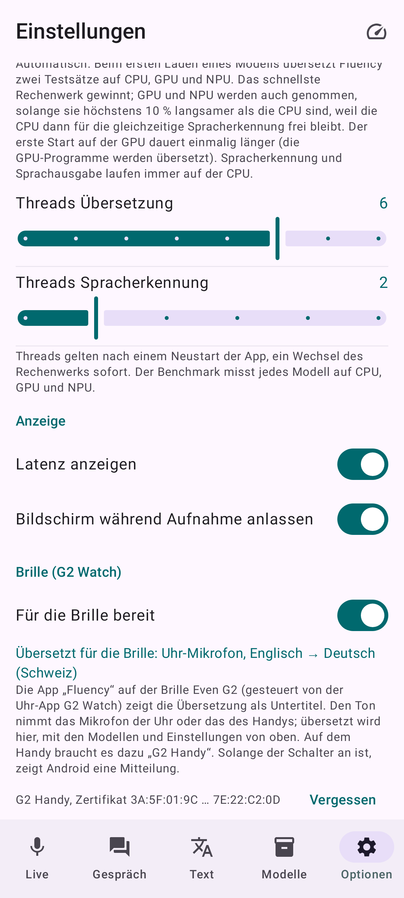

Sprachen: 54 Einträge (Deutsch, Deutsch (Schweiz), Englisch, Französisch, Italienisch, Spanisch,
Portugiesisch und alles, was Hy-MT2 und MiLMMT-46 zusätzlich können). Die App wählt automatisch ein
installiertes Modell, das das Sprachpaar beherrscht.

## Modelle

Geprüft auf Hugging Face am 6.10.2026. Es gibt Nachfolger der im Auftrag genannten Modelle:

| Rolle | Modell | Download | Sprachen | Lizenz |
|---|---|---|---|---|
| Übersetzung schnell (Standard, live + final) | **Tencent Hy-MT2-1.8B** Q4_K_M (Mai 2026, Nachfolger von HY-MT1.5) | 1.13 GB | 33 (+ Varianten) | Apache-2.0 |
| Übersetzung Qualität (optional final/Text) | **Xiaomi MiLMMT-46-4B v1.0** Q4_K_M (Aug. 2026, Gemma-3-Basis) | 2.49 GB | 46 | Gemma Terms |
| Übersetzung sehr schnell (optional) | Xiaomi MiLMMT-46-1B v1.0 Q4_K_M | 0.81 GB | 46 | Gemma Terms |
| Spracherkennung live | **NVIDIA Parakeet-TDT-0.6B-v3** int8 (sherpa-onnx) | 0.67 GB | 25 europ., automatische Erkennung | CC-BY-4.0 |
| Spracherkennung Fallback | **Whisper large-v3-turbo** int8 (sherpa-onnx) | 1.04 GB | ~100 | MIT |
| Schweizerdeutsch (Mundart → Hochdeutsch) | Whisper-large-v3-turbo-Finetune von Flurin17, GGML q5_0 (whisper.cpp), läuft als Q8_0 | 0.57 GB | gsw → de | CC-BY-NC-4.0 (privat ok) |
| Sprachaktivität | **Silero VAD v5** | 2 MB | – | MIT |
| Sprachausgabe | Android-TTS (nur Offline-Stimmen), optional **Piper** (Thorsten de, Lessac en, Siwis fr, Paola it, Davefx es, Tugão pt) | je 63 MB + 18 MB eSpeak-Daten | 6 | CC0 / CC-BY / … |

Begründung:

- **Hy-MT2-1.8B** löst HY-MT1.5 ab und schneidet laut der Vergleichstabelle im MiLMMT-Paper
  (FLORES+ en→xx: spBLEU 30.97 vs. 24.81) klar besser ab. Mit 1.8 B Parametern ist es schnell
  genug für Teilübersetzungen während des Sprechens.
- **MiLMMT-46-4B v1.0** erreicht in derselben Tabelle das Niveau von Hy-MT2-7B (WMT24++ XCOMET 85.5
  vs. 86.2) und liegt deutlich vor TranslateGemma-4B (76.0). Deshalb ist TranslateGemma nicht im
  Katalog. Es ist etwa halb so schnell wie Hy-MT2-1.8B.
- **Parakeet-v3** ist das schnellste mehrsprachige Modell (auf x86 RTF ≈ 0.1) und erkennt die
  Sprache selbst.
- **Schweizerdeutsch**: Offene Whisper-Finetunes gibt es nur im whisper.cpp-Format (GGML/GGUF),
  nicht für sherpa-onnx. Deshalb ist whisper.cpp mit eingebaut. Es nutzt dieselbe ggml-Basis wie
  llama.cpp. Das Modell ist langsamer als Parakeet (keine laufenden Teilergebnisse, nur eine
  Vorab-Erkennung pro Sprechpause) und wird nur für die Ausgangssprache „Deutsch (Schweiz)"
  verwendet. Der Encoder-Kontext wird an die Länge der Äusserung angepasst (`audio_ctx`). Auf x86
  sinkt die Zeit für 2,8 s Audio damit von 14,5 s auf 3,1 s, bei identischem Ergebnis.
  - **Läuft als Q8_0** (eingeführt in 1.3.0, seit 1.8.0 wieder drin): Die Datei hat Q5_0-Gewichte.
    Für Q5_0 hat ggml auf ARM keine schnellen Matrix-Kernels (kein i8mm, kein KleidiAI, kein
    Repacking). Beim Laden werden die Gewichte deshalb nach Q8_0 umgewandelt
    (`app/src/main/cpp/whisper_q8.h`). Das ist exakt: Ein Q5_0-Wert ist (q − 16) · d mit q = 0…31,
    das passt mit derselben Skala d in ein int8. Es wird nichts auf den Speicher geschrieben, die
    geprüfte Originaldatei bleibt, im RAM sind es 0,86 statt 0,57 GB. Auf dem Handy rechnen damit
    KleidiAI-Kernels (i8mm bzw. SME2) den Encoder.
  - Ehrlich gesagt: Die Umwandlung ist exakt, aber KleidiAI rechnet Q8_0 intern mit einer int8-Skala
    pro Gewichtszeile und quantisiert die Aktivierungen pro Zeile. Das ist nicht bitgleich zu Q5_0,
    entspricht aber dem int8-Modus von CTranslate2/faster-whisper, mit dem die Schweizer
    Whisper-Modelle verbreitet laufen. Auf x86 (ohne KleidiAI) ist der Text identisch.
  - Whisper bekommt so viele Threads wie die Übersetzung (Standard 6, mindestens 4) statt 4. Die
    Übersetzung läuft vorher oder nachher und auf diesem Handy ohnehin auf der NPU.
  - Der Benchmark misst das Schweizer Modell mit (Hochdeutsch-Clip) und zeigt „Q8_0, 6 Threads“.
- Die Modelle sind **nicht in der APK**. Beim ersten Start lädt „Empfohlene laden" Hy-MT2, Parakeet
  und Silero VAD (1.8 GB).

Hinweis zu den Low-Bit-Varianten von Hy-MT2 (1.25/2 bit): Sie brauchen einen STQ-Kernel, der nicht
in llama.cpp-master ist. Deshalb sind sie nicht im Katalog.

## Technik

```
Mikrofon (16 kHz) ─▶ Silero VAD ─▶ Utterance-Puffer ─(alle ~400 ms / sofort bei Sprechpause)─▶ Parakeet (Teil)
                                                                    └─▶ Teilübersetzung, „latest wins", Hy-MT2
                └─(Satzende: 0,4 s Stille)─▶ finale Erkennung (oder Vorab-Ergebnis) ─▶ finale Übersetzung
                                                           (oder fertige Teilübersetzung) ─▶ Vorlesen
```

- **llama.cpp** (Kopie in `third_party/`, Stand 6.10.2026), selbst gebaut per NDK r30 für arm64. Es
  gibt sieben CPU-Varianten (`GGML_CPU_ALL_VARIANTS`: armv8.0 … armv9.2 mit dotprod/i8mm/SVE/SME), die
  passende wählt die App zur Laufzeit. Dazu kommen **KleidiAI** und Q4_K/Q6_K-Weight-Repacking für i8mm.
- **GPU**: llama.cpps **OpenCL-Backend mit den Adreno-Kernels** (`libggml-opencl.so`). Es nutzt das
  `libOpenCL.so` des Herstellers (`uses-native-library`). Die Adreno 840 des S26 Ultra gehört zur
  Generation A8X. Für sie rechnet llama.cpp Q4_K/Q6_K-Gewichte (alle drei Katalogmodelle sind
  Q4_K_M) mit eigenen GEMM- und GEMV-Kernels.
  - Ein Modell läuft ganz auf der GPU oder ganz auf der CPU. Ein CPU-Modell bekommt eine leere
    Geräteliste und berührt OpenCL nie.
  - Das Backend wird erst geladen, wenn es gebraucht wird.
  - Die übersetzten GPU-Programme werden im `codeCacheDir` gespeichert (`GGML_OPENCL_KERNEL_CACHE_DIR`).
    Nur der allererste GPU-Start zahlt die Kernel-Übersetzung.
  - **Absturzschutz**: Vor jedem riskanten GPU-Schritt schreibt die App eine Markierung, nämlich vor
    dem Laden des Treibers, dem Laden auf die GPU (dabei werden die Kernels übersetzt) und den ersten
    GPU-Übersetzungen. Stirbt die App in so einem Schritt, findet der nächste Start die Markierung
    und fragt Android nach dem Grund (`ApplicationExitInfo`). Bei einem Absturz bleibt die GPU
    gesperrt, bis man sie in den Optionen wieder zulässt; es gibt also keine Absturzschleife.
    Beendet Android die App nur (Wischen, Speicher, Update), wird der Schritt beim nächsten Mal
    wiederholt.
  - Meldet llama.cpp auf der GPU einen Fehler, wird dieselbe Anfrage auf der CPU beantwortet, und
    das Modell bleibt dort.
- **NPU**: llama.cpps **Hexagon-Backend** (`libggml-hexagon.so`). Es rechnet seit dem llama.cpp-Stand
  vom 26.9.2026 auch Q4_K/Q6_K-Gewichte, also unsere Q4_K_M-Modelle.
  - Auf der NPU läuft ein eigenes Programm, je eines pro Hexagon-Generation: `libggml-htp-v73.so`
    (8 Gen 2), `v75` (8 Gen 3), `v79` (8 Elite) und `v81` (8 Elite Gen 5, S26 Ultra). Das Backend
    fragt die NPU nach ihrer Version und lädt das passende.
  - Die Verbindung läuft über FastRPC: `libcdsprpc.so` des Herstellers (`uses-native-library`), als
    „unsigned PD“, also ohne Root und ohne Qualcomm-Signatur. Die App setzt `ADSP_LIBRARY_PATH` auf
    ihren Bibliotheksordner, damit FastRPC das NPU-Programm findet, und `GGML_HEXAGON_OPPOLL=1`
    (Warten auf Ergebnisse per Polling, weniger Latenz pro Token).
  - Wie bei der GPU: Das Backend wird erst bei Bedarf geladen. Ein Modell läuft ganz auf der NPU.
    Laden, erste Läufe und Test sind über den Absturzschutz abgesichert, und ein Fehler führt
    zurück auf die CPU. Ein Absturz sperrt nur die NPU, nicht die GPU, und umgekehrt.
  - Beide Beschleuniger-Backends melden sich in ggml als „GPU“. Die JNI-Brücke unterscheidet sie
    deshalb am Namen des Backends („OpenCL“ bzw. „HTP“). C++-Ausnahmen der Backends (z. B. wenn ein
    Gerät die NPU-Sitzung verweigert) fängt sie ab.
  - Gebaut wird das Hexagon-Backend mit Qualcomms **Hexagon SDK 6.6** (Hexagon Tools 19.0.07). Weil
    das SDK nicht frei im Netz liegt, liegen die fertigen Bibliotheken in `app/src/main/jniLibs`;
    Android Studio braucht das SDK also nicht. Neu bauen (nach jeder Änderung an llama.cpp nötig,
    weil `libggml-hexagon.so` gegen die `libggml-base.so` der App gelinkt ist):
    `native/fetch-hexagon-sdk.sh` (holt das SDK aus llama.cpps Snapdragon-Toolchain-Image
    `ghcr.io/snapdragon-toolchain/arm64-android:v0.7`, nur die SDK-Schicht, mit Prüfsumme), dann
    `native/build-hexagon.sh`. Woraus die Bibliotheken gebaut wurden, steht in
    `native/HEXAGON_BUILT_FROM`.
- **JNI-Brücke** (`app/src/main/cpp/fluency_jni.cpp`): Das Modell bleibt warm im Speicher. Der
  **KV-Cache wird wiederverwendet**, es wird nur der Prompt-Teil neu berechnet, der sich geändert
  hat (bei wachsenden Teilsätzen kommen z. B. 31 von 41 Tokens aus dem Cache). Tokens werden
  gestreamt (nur vollständige UTF-8-Zeichen), Abbruch geht jederzeit. Die Prompts sind die kürzesten
  offiziellen Formate (Hy-MT2-Chat-Template bzw. MiLMMT-Completion), Decoding greedy.
- **sherpa-onnx 1.13.8** (VAD, ASR, Piper) aus dem Quellcode gebaut gegen ONNX Runtime 1.28.0 (aus
  Maven), siehe `native/build-sherpa-onnx.sh`. Die gebaute `libsherpa-onnx-jni.so` liegt in
  `app/src/main/jniLibs`.
- **whisper.cpp 1.9.5** für Schweizerdeutsch, statisch in `libfluency_jni.so`. Q5_0-Modelle werden
  beim Laden exakt nach Q8_0 umgewandelt (siehe Modelle).
- **Brille** (`glasses/`):
  - `GlassesService` ist ein exportierter Dienst mit der Aktion `ch.madtreasures.g2watch.action.LINK`.
    G2 Handy bindet ihn und schickt `Messenger`-Nachrichten: `OPEN` = 1 (Bundle `app`, `version`),
    `OPENED` = 2 (Antwort), `MSG` = 3 (`text`, beide Richtungen), `CLOSE` = 4 (`message`: warum, beide
    Richtungen, auch wenn Fluency ein `OPEN` ablehnt), `AUDIO_START` = 5 (`pfd`: Leseende einer Pipe,
    `rate` = 16000), `AUDIO_STOP` = 6. Jede Nachricht muss von der UID kommen, die die Verbindung
    geöffnet hat (`Message.sendingUid`).
  - Der Dienst läuft im Vordergrund (`connectedDevice`, mit Mikrofon-Erlaubnis auch `microphone`).
  - `WatchAudio` liest den Ton der Uhr (PCM s16le, 16 kHz, mono) und gibt ihn in Blöcken zu 512 Samples
    an die Pipeline, wie `MicrophoneSource`. Endet der Strom, wartet dieselbe Quelle auf den nächsten.
  - `GlassesBridge` setzt das Protokoll um. Sie steuert eine `LivePipeline` und schickt deren
    Äußerungen; abgebrochene schickt sie als `gone`. Ändert sich nur Vorlesen oder „schon beim
    Sprechen zeigen“, läuft die Pipeline weiter; ändern sich Ton oder Sprachen, startet eine neue.
    Nach „stop“ wird der angefangene Satz fertig übersetzt, ein neuer Start wartet nicht darauf. Kommt
    5 s lang kein Ton von der Uhr, erfährt es die Brille einmal.
  - `PipelineFactory` lädt die Modelle für Live, Gespräch und Brille gleich.
- Native Libraries werden bei der Installation entpackt (`useLegacyPackaging = true`). Das ist nötig,
  weil die App die passende `libggml-cpu-*.so`, die Backends und die NPU-Programme im
  Bibliotheksordner sucht und lädt. Alle ARM-Bibliotheken sind 16-KB-ausgerichtet; die
  NPU-Programme (Hexagon-Code) packt Gradle unverändert ein. Release mit R8 (JNI-Klassen bleiben
  erhalten) und Signatur v3.

## Bauen (Kommandozeile)

Voraussetzungen: JDK 21, Android SDK (Platform 37, Build-Tools 37.0.0, NDK 30.0.16248370, CMake
3.31.6).

```bash
git clone https://github.com/MADTreasures/playground && cd playground/fluency
echo "sdk.dir=/pfad/zum/android-sdk" > local.properties
./gradlew :app:assembleDebug                 # oder assembleRelease (siehe Signieren)
```

Die nativen Abhängigkeiten liegen als Kopie in `third_party/`, gekürzt auf das, was der Build
braucht. Herkunft und Commit stehen jeweils in `VENDORED_FROM`. Aktualisieren:
`tools/vendor-third-party.sh` (Commits im Skript anpassen). Das Android-Studio-ZIP erzeugt
`tools/make-studio-zip.sh`.

`libsherpa-onnx-jni.so` neu bauen (optional, nur bei einem Versionswechsel):
`native/build-sherpa-onnx.sh android`. Die Abhängigkeiten werden in diesem Skript beschrieben; die
GitHub-Release-Downloads werden dabei nicht benötigt.

**Signieren**: `keystore.properties` im Projektordner (nicht im Repo, Vorlage
`keystore.properties.example`) mit

```
storeFile=/pfad/fluency-release.jks
storePassword=…
keyAlias=fluency
keyPassword=…
```

oder per Umgebungsvariablen `FLUENCY_KEYSTORE`, `FLUENCY_KEYSTORE_PASSWORD`, `FLUENCY_KEY_ALIAS`,
`FLUENCY_KEY_PASSWORD`. Updates müssen mit **demselben Schlüssel** signiert werden (Zertifikat
SHA-256 `81:05:E7:DE:…:9C:6A`), sonst verweigert Android die Installation über die alte Version.

In einer Cloud-Umgebung, in der Geheimnisse nur Umgebungsvariablen sein können (z. B. Claude Code
im Web), kommt die Schlüsseldatei selbst als Text in `FLUENCY_KEYSTORE_BASE64`. Der Build schreibt
sie dann nach `.gradle/signing/` (nicht im Repo, nicht im ZIP). Den Text erzeugt man so:

```
PowerShell:  [Convert]::ToBase64String([IO.File]::ReadAllBytes("C:\pfad\mein.jks")) | Set-Clipboard
macOS:       base64 -i mein.jks | pbcopy
Linux:       base64 -w0 mein.jks
```

Modellkatalog aktualisieren (neue Commits/Hashes von Hugging Face): `python3 -I tools/gen_model_files.py`.

## Tests

```bash
./native/build-host-jni.sh                   # llama.cpp + whisper.cpp JNI für x86-64
./native/build-sherpa-onnx.sh host           # sherpa-onnx JNI für x86-64
FLUENCY_MODEL_DIR=/pfad/zu/modellen ./gradlew :app:testDebugUnitTest
```

Ohne diese Bibliotheken bzw. Modelle werden die Integrationstests übersprungen; die übrigen
Tests laufen immer. Erwartete Ordnerstruktur (Standard: `test-models/` im Projekt):
`llm/` (die drei GGUF-Dateien), `parakeet-v3/` (encoder/decoder/joiner.int8.onnx, tokens.txt,
test_wavs/), `whisper-turbo/`, `swiss-whisper/ggml-model-q5_0.bin`, `vad/silero_vad_v5.onnx`.

146 Tests in 26 Klassen, alle grün:

- **Logik**: Schweizer Schreibweise, Satz-Segmentierung, Spracherkennung per Stoppwörtern/Schrift,
  Prompt-Formate, Modell-Routing, Katalog (gepinnte URLs, SHA-256), **Downloader** (Fortsetzen nach
  Verbindungsabbruch, `.part` aus früherem Lauf, Server ignoriert Range, falscher Hash), WAV,
  **Live-Pipeline** mit Fakes (Teil- und Endergebnisse, Reihenfolge, Vorlesen, Auto-Stopp).
- **CPU/GPU/NPU-Wahl** mit simulierten Modellen auf CPU, GPU und NPU. Im Container gibt es weder
  eine Adreno-GPU noch eine Hexagon-NPU. Getestet wird dieselbe Engine-Logik wie auf dem Handy:
  - Das schnellste Rechenwerk übernimmt ohne Pause. Sind GPU und NPU langsamer, bleibt es bei der
    CPU. Eine NPU mit falscher Ausgabe schlägt eine korrekte GPU nicht.
  - Die Messung wartet, solange übersetzt wird.
  - Eine gespeicherte Entscheidung lädt das Modell direkt dort.
  - „Nur CPU“ berührt GPU und NPU nie.
  - Ein NPU-Fehler beantwortet dieselbe Anfrage auf der CPU; ein fehlgeschlagenes NPU-Laden wird
    genau einmal versucht.
  - Eine gesperrte NPU bleibt aus, bis man sie wieder zulässt; die GPU bleibt davon unberührt.
  - Ein Wechsel der Einstellung (CPU → NPU → GPU → CPU) wirkt ohne Neustart.
  - Der Benchmark kann jedes Rechenwerk erzwingen.
  - Dazu die Absturz-Markierung je Rechenwerk, das Speichern der Entscheidungen (inkl. Zurücksetzen
    nach einem Update) und Auswahlregel und Textvergleich.
- **Echte Modelle auf dem x86-Container über dieselbe JNI wie in der App**:
  - Hy-MT2: Streaming, KV-Cache-Wiederverwendung, Abbruch, CJK-Ausgabe.
  - Alle sechs Kernsprachen, Auto-Quelle, Absätze, Schweizer „ss":
    „Die Strasse ist sehr gross. Grüsse aus der grossen Stadt!"
  - MiLMMT 1B/4B, inkl. Schwedisch.
  - Parakeet (de/en/fr/es) und Whisper-turbo (inkl. Spracherkennung).
  - Silero VAD mit absoluten Segmentpositionen.
  - Schweizerdeutsch-Whisper über whisper.cpp, geladen als Q8_0 (gleicher Text wie mit Q5_0); der
    App-Benchmark misst es als „Q8_0, 4 Threads“ mit.
  - Echter Download von Hugging Face inkl. SHA-256 (Silero, 355 eSpeak-Dateien, Piper).
  - Piper spricht, Parakeet erkennt: „Guten Morgen, wie komme ich zum Bahnhof?"
  - **Live-Pipeline Ende-zu-Ende** (Audio → VAD → Parakeet → Hy-MT2) und der App-Benchmark
    (prüft u. a., dass ein wiederholter Prompt bis auf das letzte Token aus dem KV-Cache kommt).
  - Die echte JNI meldet auf x86 „kein GPU-Backend“ und „kein NPU-Backend“; der Automatikmodus
    bleibt dann auf der CPU.
- **Wortlisten** (Funktion 8):
  - Dateiformat lesen und schreiben (Formen, Erklärungen mit Klammern, Originalwörter, Kommentare,
    Abschnitte pro Sprache des Originals; Schweiz = Deutsch).
  - Eine Doppeldeutung für Deutsch erscheint bei deutschem und schweizerischem Original, nicht bei
    französischem; bei unbekannter Sprache (automatisch) zählt nur das Wort.
  - Wörter in der Übersetzung finden: nur ganze Wörter („bankrupt“ und „Bankkonto“ nicht), ß = ss,
    Ausdrücke aus mehreren Wörtern, Apostrophe, Chinesisch ohne Leerzeichen, koreanische Endungen.
  - Originalwörter mit Endungen und Umlauten („Bänke“, „Banken“, „Schlösser“).
  - Mehrzahl wird zu Mehrzahl, Grossschreibung am Satzanfang, Grossbuchstaben, deutsche Nomen;
    „Deutsch (Schweiz)“ schreibt „ss“. Überlappende Wörter (das längere gewinnt), mehrere Stellen,
    ein Wort in zwei Gruppen.
  - Speicher: eine Datei pro Sprache, Startliste bis zur ersten Änderung, zurücksetzen,
    Deutsch (Schweiz) = Deutsch, Ergänzen ohne Doppelte, Text speichern.
  - Übernahme der eigenen Wörter aus 1.5.0/1.6.0.
  - Startlisten: genau so geschrieben, wie die App schreibt; jede Doppeldeutung hat ihre Sprache und
    ihr Wort des Originals; keine doppelte, kein „ß“; **jede Form jedes Wortes wird gefunden und
    bietet die anderen an**.
  - Bedienung (Robolectric): Doppeldeutung ändern, neu anlegen (erst ab zwei Übersetzungen
    speicherbar, bekommt die Sprache der Seite), löschen, ohne die anderen Sprachen anzufassen;
    Stern setzt und entfernt Favoriten; die Sprachen öffnen ihre Seiten; am Knopf Finger drauf →
    Wort markiert, wegziehen → nichts ersetzt, tippen → ersetzt.
- **Brille (G2 Watch)**, ohne Uhr, Brille und G2 Handy:
  - Protokoll: Lesen und Schreiben jeder Nachricht, Standardwerte, unbekannte Typen und Felder,
    fehlerhafte Anfragen, Anführungszeichen, Zeilenumbrüche, Chinesisch und Emoji.
  - Ton der Uhr: PCM in Stücken, die mitten in einem Sample enden; ein neuer Strom für dieselbe
    Pipeline; ohne Zuhörer verworfen; nur die neueste Pipeline hört; wann zuletzt Ton kam.
  - Brücke mit simulierter Pipeline und virtueller Zeit:
    - Start lädt die Modelle („Lädt die Modelle …“) und hört dann auf die Uhr.
    - Sätze, die gerade gesprochen werden, höchstens alle 250 ms, immer der neueste Stand; fertige
      sofort und nur einmal; ohne „schon beim Sprechen“ nur fertige.
    - Verworfene Sätze gehen als `gone`.
    - Vorlesen ändern lässt die Pipeline laufen, eine andere Sprache startet eine neue.
    - Stopp übersetzt den angefangenen Satz fertig; Stopp während des Ladens; ein neuer Start wartet
      nicht auf den alten.
    - Fehlendes Modell, unbekannte Sprache, Handy-Mikrofon nicht erlaubt, Pipeline bricht ab, kein Ton
      von der Uhr (einmal); nach dem Trennen kommt nichts mehr.
  - Dienst (Robolectric): Nur die Aktion `…LINK` bindet. G2 Handy kommt herein, sein Zertifikat wird
    gemerkt, und „hello“ bekommt „welcome“ zurück. Andere Apps, ein anderes Zertifikat und der
    ausgeschaltete Schalter werden abgelehnt; eine fremde App kann nicht in eine offene Verbindung
    schreiben; Ausschalten trennt.
- **Robolectric-Screenshots** aller Bildschirme (`docs/screenshots`), dazu die drei Ebenen der
  Wortlisten (`11_word_lists`, `12_word_sources`, `13_word_pair`) und der gedrückte Knopf mit
  markiertem Wort (`10_word_preview`).

Messwerte auf dem Container (4 vCPU x86, nur Korrektheitsreferenz, das Handy ist schneller):
Hy-MT2 17 Tok/s, MiLMMT-1B 23 Tok/s, MiLMMT-4B 7 Tok/s, Parakeet RTF 0.12. Live-Pipeline vom
Satzende bis zur fertigen Übersetzung: 1.6 s.

## Messwerte auf dem Handy

Benchmark der App 1.2.0 auf einem Galaxy Z Fold (SM-F976B) mit Snapdragon 8 Elite Gen 5 (SM8850,
derselbe Chip wie im S26 Ultra), Android 17, 6 Threads, 7.10.2026. Die App wählt die CPU-Variante
`armv9.2_2` (SVE2/SME).

Hy-MT2 1.8B (Q4_K_M):

| | CPU | GPU (Adreno) | NPU (Hexagon v81) |
|---|---|---|---|
| Ø pro Satz | 709 ms | 767 ms | **555 ms** |
| Prompt einlesen | 215 Tok/s | 326 Tok/s | **936 Tok/s** |
| Ausgabe | **41.8 Tok/s** | 33.1 Tok/s | 41.1 Tok/s |
| Wiederholung mit KV-Cache (Live-Teilübersetzung) | **406 ms** | 536 ms | 420 ms |
| Laden | **762 ms** | 3011 ms | 2444 ms |

- Die Automatik nimmt die NPU. Sie liest 4,4× schneller ein als die CPU und ist bei ganzen Sätzen
  22 % schneller. Beim Schreiben sind CPU und NPU gleich schnell, begrenzt durch die
  Speicherbandbreite.
- Bei Live-Teilübersetzungen liegt der Prompt grösstenteils im KV-Cache, deshalb sind CPU und NPU
  dort praktisch gleich schnell. Mit der NPU bleibt die CPU für die Spracherkennung frei.
- Die GPU schreibt langsamer und wird nicht genommen.
- Damit ist bestätigt: Die NPU-Sitzung (FastRPC, unsigned PD, ohne Root) läuft in der App, das
  NPU-Programm v81 lädt, und die Ausgabe stimmt mit der CPU überein.

Parakeet-TDT 0.6B v3: 365 ms für 6,6 s Audio (Echtzeitfaktor 0,055).

## Was nur auf dem Handy getestet werden kann

- Mikrofon-Aufnahme, Echo/Rückkopplung beim Vorlesen, Android-TTS-Offline-Stimmen.
- Wie sich das Drücken der Ersetzen-Knöpfe auf dem Handy anfühlt (Markierung erscheint nach ca.
  0,1 s Fingerdruck, Wegziehen bricht ab), auch im Gesprächsmodus auf dem Kopf; wie oft die
  Startlisten bei echten Gesprächen einen passenden Knopf zeigen.
- Export und Import der Wortlisten über die Android-Dateiauswahl.
- Die Übernahme eigener Wörter aus 1.6.0 mit deinen echten Daten (getestet mit Beispielzeilen) und
  das Update ohne Verlust der Modelle.
- Foreground-Service-Downloads im Hintergrund, Benachrichtigungen, SAF-Dateiimport.
- Schweizerdeutsch-Qualität mit echter Mundart (getestet wurde nur Hochdeutsch-Audio).
- Wie viel schneller Schweizerdeutsch als Q8_0 auf dem Handy ist. Auf x86 gibt es die ARM-Kernels
  (i8mm/KleidiAI/SME2) nicht; dort ist Q8_0 nur gleich schnell bis etwas schneller. Erwartet wird
  auf dem Handy ein Mehrfaches, gemessen ist es noch nicht (der Benchmark der App zeigt es).
- Speicherverbrauch und Wärmeentwicklung bei langen Sitzungen.
- **Brille (G2 Watch)**: alles mit der echten Kette, sobald die Uhr-App sie hat (Schnittstelle 4, G2
  Handy): Verbinden, Ton der Uhr über Bluetooth, Verzögerung bis zum Untertitel auf der Brille. Dazu das
  Handy-Mikrofon im Hintergrund über den Vordergrund-Dienst (Android 17), die Mitteilung mit
  „Ausschalten“ und das Merken des Zertifikats von G2 Handy.

## Lizenzen

App-Code: privat. Komponenten: llama.cpp, whisper.cpp und ggml (MIT), sherpa-onnx (Apache-2.0),
ONNX Runtime (MIT), KleidiAI (Apache-2.0), OpenCL-Headers/ICD-Loader (Apache-2.0), eSpeak-NG-Daten
(GPL-3.0). Die NPU-Bibliotheken sind aus dem llama.cpp-Quellcode (MIT) mit Qualcomms Hexagon SDK
gebaut (Qualcomm-Lizenz, private Nutzung). Modelle: siehe Tabelle oben. Sie werden nicht mitgeliefert, sondern vom Nutzer
heruntergeladen. Einige sind nur für die nicht-kommerzielle Nutzung freigegeben.
